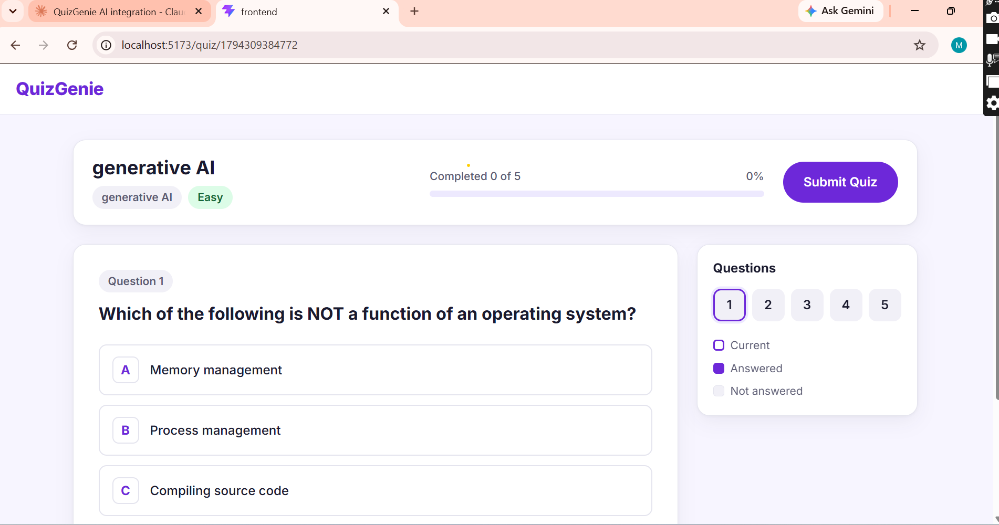
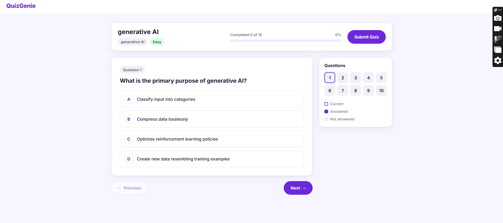

# Prompt Log – QuizGenie (Frontend)

| # | Prompt (short) | What AI gave | What was wrong | How we fixed it | Member |
|---|---|---|---|---|---|
| 1 | Generate a README for QuizGenie (description, features, tech stack, API endpoints, setup, usage, team, GitHub collaboration) | Full README in Markdown | Some fields were placeholders (clone URL, team names, database name, start command) | Added my own name; other placeholders will be filled before final submission | Mahnoor |

| 2 | Create src/mock/mockQuiz.js with mockQuizList, mockQuiz (without correct answers) and mockAttemptResult (4/5 correct), using exact field names | Mock data file with 3 named exports | Nothing wrong. Checked field names against our API contract and checked answers manually | No fix needed | Mahnoor |

| 3 | How to test the mock data file from the terminal without creating a new file | Node commands that check exports, field values, hidden answers and score | Nothing wrong. All 8 checks returned true | No fix needed | Mahnoor |

| 4 | Routing for 3 screens using react-router-dom 7.18.5 | main.jsx (router setup), App.jsx (routes + header), 3 placeholder pages | Nothing wrong. Used the correct v7 syntax (Routes + element, not old Switch) | No fix needed. Tested /, /quiz/1, /results, /abc in browser | Mahnoor |

| 5 | Data service file quizApi.js with CRUD functions, mock on/off switch, loading delay and error handling | quizApi.js with 6 functions using mock data or axios | 2 mismatches with our API contract: errors were read from "message" instead of "error", and the PDF field was named "pdf" instead of "file" | Fixed by hand: changed to data?.error and formData.get("file") | Mahnoor |

| 6 | How to test all quizApi.js functions from the terminal without creating a file | Node command testing all CRUD functions, submit, empty form error and wrong id error | AI said to run it from the main project folder, but the src folder is inside frontend, so it must be run from the frontend folder | Ran it from the frontend folder; all 8 checks passed (screenshot: quizapi-test.png) | Mahnoor |

| 7 | Vague prompt: "Create a quiz generator form in React. The user should be able to type a topic or upload a PDF, pick a difficulty level and how many questions they want, then press a button to generate the quiz." | QuizForm.jsx, QuizForm.css and Home page update | Sent PDF as "pdf" instead of "file" (mismatch with API contract); no file size limit; error not announced to screen readers; Topic/PDF tabs don't tell screen readers which one is selected; no keyboard focus style; no mobile adjustments; labels centered and low contrast on dark background | Kept as the vague version for comparison; fixed with a detailed prompt | Mahnoor |

| 8 | Detailed prompt: rebuild the same QuizForm with clear requirements for data, validation, accessibility, responsiveness and state | New QuizForm.jsx and QuizForm.css meeting all the requirements | AI also told me to change formData.get("pdf") to "file" in quizApi.js, but this was already fixed earlier, so the instruction was outdated | Did not apply the outdated change; used the new QuizForm and CSS and tested them on desktop and mobile | Mahnoor |

| 9 | Home page: saved quiz list (SavedQuizList.jsx + CSS) below the QuizForm with Start, Rename and Delete, plus loading, empty and error states | SavedQuizList.jsx, SavedQuizList.css and updated Home.jsx | Nothing wrong. AI chose an in-card delete confirmation instead of a browser pop-up, which works better with keyboard and screen readers. With mock data, renamed and deleted quizzes come back after a page refresh (expected until the real backend is connected) | No fix needed. Tested list loading, empty title error, rename, delete with confirmation and cancel, empty list message, Start button and mobile layout | Mahnoor | (screenshots: home-mobile.png, home-delete-confirm.png)

| 10 | Attempt Quiz and Results screens with a professional light theme: design system (CSS variables, Inter font), summary bar with progress, A–D option cards, question navigator, unanswered check, grade and breakdown cards, answer review, Try Again, and mobile layout | index.css, App.css, QuestionCard.jsx/.css, AttemptQuiz.jsx/.css, Results.jsx/.css | Nothing wrong in the new code. AI noticed that App.jsx was not importing App.css (left out in the earlier routing code), so the header styles would not apply. With mock data every quiz shows the same 5 OS questions (expected until the backend and AI are connected) | Added import "./App.css" to App.jsx. Tested answering, Previous/Next, navigator, unanswered warning, submit, results, Try Again, refresh (No result found), keyboard and mobile layout | Mahnoor |

| 11 | Restyle the Home page (QuizForm and Saved Quizzes) to the same light theme, two-column layout on large screens | AI rewrote QuizForm.css and SavedQuizList.css with the index.css variables, added Home.css for the grid layout and one import in Home.jsx | Before pasting, I checked with Select-String that every CSS variable the AI used actually exists in index.css. All were present, so no change was needed. This also fixed the earlier issue where the saved quiz headings were dark text on a dark card. Tested on desktop, iPhone SE view and keyboard Tab focus. |

# Prompt Log – QuizGenie (AI Integration)

| 1 | Asked AI to explain how `aiService.js` talks to OpenAI, builds the prompt and handles the questions | A simple step-by-step explanation, plus weak points: fake questions are used when the AI fails, the right answer is often option A, the number of questions is not checked, and a possible problem with loading the `.env` file | The `.env` loading problem was only a guess, not confirmed | Shared `server.js` to check it | Eman Ansar |

| 2 | Asked AI to check whether `server.js` loads the `.env` file before the AI service starts | Confirmed `.env` loads first, so no problem there. It also said the "API key" message on startup was a bug | AI got this wrong. That message checks our app's own password (`API_KEY`), not the OpenAI key | AI corrected itself after seeing `quizRoutes.js` and `auth.js` | Eman Ansar |

| 3 | Asked AI to explain `quizRoutes.js` and how a request reaches the AI | Explained each step of the request. Found that fake quizzes get saved as real ones, uploaded PDFs are left on disk when the input is wrong, and the saved question count can be different from the real count | Some PDF worries were too strong because AI hadn't seen the PDF code yet | Checked `pdfService.js` next and AI corrected those points | Eman Ansar |

| 4 | Asked AI to check how PDFs are read (scanned, empty and long PDFs) | Empty PDFs are already rejected and text is limited to 8,000 characters. A scanned PDF with only page numbers can still pass, and long lectures only use the first few pages | AI had earlier said there was no size limit, which was wrong | Noted these as known limits for later | Eman Ansar |

| 5 | Asked AI to review `validate.js` (topic, difficulty, number of questions) | Difficulty and question count only accept fixed values, which is good. Short topics like "AI" are rejected, and an empty topic box might block PDF uploads | Some issues depend on how the frontend sends data | Noted them for testing | Eman Ansar |

| 6 | Asked AI to judge the prompt used to make the questions | The prompt only controls the format. It doesn't tell the AI to stick to the lecture, doesn't explain the difficulty levels, has no rules for wrong options, and its example pushes the right answer to option A | The old prompt didn't control quality | Asked AI to write a better prompt | Eman Ansar |

| 7 | Asked AI to rewrite only the prompt: topic mode and PDF mode, clear difficulty levels, good wrong options, useful explanations, same JSON fields | A new prompt with clear rules for each part. To tell topic and PDF apart, it checked the text length (over 200 characters = PDF) | Text length isn't reliable: a short PDF would be treated as a topic | I asked for a clear `sourceType` value instead. The route now sends "pdf" when a file is uploaded and "topic" otherwise | Eman Ansar |

| 8 | Tested: typed "generative AI" and chose 10 questions | Asked me to check the backend terminal, the browser Network tab and search the code | The app showed 5 operating system questions. The backend received nothing, and the app password (`API_KEY`) was missing, so requests were rejected | Made the backend skip the password check when no `API_KEY` is set (only for local testing) | Eman Ansar |

| 9 | The backend said the OpenAI key was missing | Steps to check the `.env` file | There was no `.env` file, only `.env.example`, so the key was never loaded | Created `.env`, kept the real key out of `.env.example`, and added a startup message showing whether the AI key is loaded | Eman Ansar |

| 10 | Still seeing the same OS questions | Found that the frontend uses test data from `mockQuiz.js` through `quizApi.js` | The frontend was still in test mode (`USE_MOCK = true`) and the backend address still said `[PORT]` | Turned test mode off and set the address to `http://localhost:5000/api` | Eman Ansar |

| 11 | The quiz showed "Sample question 1" and "Correct answer 1" | Explained that these are fake backup questions and showed where the real error appears in the terminal | The terminal said the key was invalid: the example key from the AI's message was still in `.env`. The app hid the error and showed fake questions instead | Put in a real key. Hiding errors is still to be fixed | Eman Ansar |

| 12 | Asked for a free API instead of paid OpenAI | Suggested Groq, which is free and works like OpenAI. The provider and model can now be changed from `.env` | Nothing wrong | `aiService.js` now reads the address and model from `.env`. Without them it still uses OpenAI | Eman Ansar |

| 13 | Groq said "Invalid API Key" | A safe check showing only the start and length of the key | The key was only 22 characters instead of about 56. I had copied the hidden/short version | Made a new key, copied it from the popup, and checked the length | Eman Ansar |

| 14 | Groq said the model was not found | A command to list the models our key can use | The model AI suggested (`llama-3.3-70b-versatile`) was no longer available | Listed the models and switched to `openai/gpt-oss-120b` | Eman Ansar |

| 15 | Tested topics, a text PDF, an image-only PDF and other file types | Explained what should happen in each case | No bug. The app can't read text inside images, and only PDFs can be uploaded on purpose | Topic quiz works , PDF questions come from the file , image-only PDF shows "PDF has no readable text" . Reading images is a future idea | Eman Ansar |

## Problems Found and Fixed in AI-Generated Code
### Problem 1: Silent Fallback Hid AI Failures

**File:** `backend/services/aiService.js`

**What was wrong:**
When the AI call failed for any reason (wrong API key, wrong model name, network error), the code quietly created fake questions like "Sample question 1" and "Correct answer 1". These fake questions were saved in the database and shown to the student as a successful quiz.

**Why it was a serious problem:**
- The app looked like it was working, even when the AI was not working at all.
- The real error was only visible in the backend terminal.
- It hid two real errors during testing: a 401 (invalid API key) and a 404 (model not found).
- In a live demo, fake questions could be shown without anyone noticing.

**How I found it:**
I generated a quiz on "generative AI" and got "Sample question 1…" instead of real questions. The backend terminal showed `AI failed: 401 Invalid API Key → fallback`.

**How I fixed it:**
- When the AI fails, the code now throws a clear error instead of making fake questions.
- The student sees: *"Quiz generation failed. Please try again."* (status 502).
- Nothing is saved in the database when the AI fails.
- Fake questions are only used if a developer turns them on on purpose with `AI_FALLBACK=true` in `.env`.

**Evidence:**
- Before: 


- After: 


### Problem 2: Topic/PDF Mode Detected by Text Length (Non-Trivial problem Found by me) 

**File:** `backend/services/aiService.js`

**What was wrong:**
The AI-suggested code decided whether the input was a topic or a PDF using its length:

```javascript
const isLecture = source.length > 200;
```

**Why it was a problem:**
- A short PDF (200 characters or less) would be treated as a topic, so the AI would use general knowledge instead of the lecture content.
- The code secretly depended on the 200-character topic limit in another file (`validate.js`). If someone changed that limit, mode detection would break without any warning.

**How I found it:**
While reviewing the AI's suggested code, I noticed that text length is not a reliable way to know where the input came from.

**My prompt to the AI:**
> "A topic can be longer than 200 characters and a PDF can contain less than 200 characters. So source length is not a reliable way to identify the mode. Please revise your solution to use an explicit `sourceType` value."

**How I fixed it:**
- The route now passes `sourceType: file ? "pdf" : "topic"` to the AI service.
- The server decides the mode based on whether a file was actually uploaded, so the user cannot fake it.
- The frontend did not need any changes.

**Evidence:**
Before


After


---

### Problem 3: Empty PDF Returned Server Error 500 Instead of 400 (Non-Trivial problem Found by me) 

**Files:** `backend/services/pdfService.js`, `backend/middleware/errorHandler.js`

**What was wrong:**
`pdfService.js` threw an error without a status code:

```javascript
if (!text) throw new Error("PDF has no readable text");
```

The error handler uses `err.status || 500`, so an empty PDF was reported as **500 (server error)**.

**Why it was a problem:**
- An empty PDF is the user's mistake, so it should be **400 (bad request)**, not 500.
- Wrong status codes make debugging and monitoring confusing.
- In production mode, the error handler would replace the message with "Server error", so the student would not know what went wrong.

**How I found it:**
I tested with an empty PDF and image-only PDF and checked how the error was handled between the two files.

**How I fixed it:**
- Empty PDFs now return **400** with "PDF has no readable text".
- Damaged or password-protected PDFs now return **400** with a clear message.
- AI failures return **502**, and missing AI setup returns **503**.
- The error handler now hides only unexpected 500 errors in production, and keeps helpful messages for other errors.

**Evidence:**
Before

After


### Problem 4: Frontend Was Never Connected to the Backend

**File:** `frontend/src/api/quizApi.js`

**What was wrong:**
- `USE_MOCK = true`, so the frontend always used sample data.
- The backend URL still had a placeholder: `http://localhost:[PORT]/api`.
- Every quiz showed the same 5 operating system questions, no matter which topic or number of questions was chosen.

**How I found it:**
I entered "generative AI" with 10 questions but got 5 questions about operating systems. The backend terminal showed no activity, and the quiz ID in the URL was a timestamp, which proved the request never reached the backend.

**How I fixed it:**
- Set `USE_MOCK = false`
- Set `API_BASE_URL = "http://localhost:5000/api"`

**Evidence:**
Before: 
After: 

### Problem 5: Correct Answer Position Bias

**File:** `backend/services/aiService.js`

**What was wrong:**
The original prompt example showed `"correctIndex": 0`. AI models tend to copy examples and often put the correct answer first, so students could guess by always choosing option A.

**Why a prompt alone cannot fix it:**
AI models are not good at real randomness. Even when asked to vary positions, they still follow patterns.

**How I fixed it:**
Added a `shuffleOptions()` function that randomly reorders the 4 options in code (Fisher-Yates shuffle) and updates `correctIndex` to the new position of the correct answer.

**Evidence:**

Generated 4 quizzes (35 questions). The terminal printed the AI's positions and the positions after shuffling.

| Position | Before shuffle (AI) | After shuffle (code) |
|---|---|---|
| 0 (A) | 11 (31%) | 6 (17%) |
| 1 (B) | 13 (37%) | 9 (26%) |
| 2 (C) | 6 (17%) | 10 (29%) |
| 3 (D) | 5 (14%) | 10 (29%) |
| A + B together | **24 (69%)** | 15 (43%) |


### Problem 6: Hidden Default Model Did Not Match the Provider (Non-Trivial problem Found by me) 

**File:** `backend/services/aiService.js`

**What was wrong:**

```javascript
const AI_MODEL = process.env.AI_MODEL || "gpt-4o-mini";
```

We switched to Groq, but the default was still an OpenAI model. If `AI_MODEL` was missing in `.env`, the app would ask Groq for a model it doesn't have and fail with a confusing 404 error.

**How I fixed it:**
- Removed the hidden default.
- If the model is missing, the student gets a clear message (503), and the terminal says exactly what is missing.
- The backend startup now shows the active model.

---
## Frontend/Backend Mismatches

### Mismatch 1: Frontend Still Using Mock Data

**Problem:** `quizApi.js` still had `USE_MOCK = true` and a placeholder URL (`localhost:[PORT]`). The frontend never called the backend, so every quiz showed the same 5 operating system questions, whatever the topic or count.

**How I found it:** I entered "generative AI" with 10 questions and got 5 OS questions. The backend terminal showed no activity.

**Fix:**
```javascript
const USE_MOCK = false;
const API_BASE_URL = "http://localhost:5000/api";
```




---

### Mismatch 2: Missing API Key Header

**Problem:** The backend requires an `x-api-key` header for create, rename and delete, but the frontend did not send it. Both sides worked alone but did not agree, so these requests were rejected (401).

**Fix:** Added the header once to the shared axios instance, so every request sends it:
```javascript
const api = axios.create({
  baseURL: API_BASE_URL,
  headers: { "x-api-key": import.meta.env.VITE_API_KEY },
});
```
`VITE_API_KEY` in `frontend/.env` must match `API_KEY` in `backend/.env`.

---

## Other Problems Solved

| Problem | Fix |
|---|---|
| Auth could switch off silently when `API_KEY` was missing | Restored the safe check: no key → requests rejected with a clear error |
| Startup message said "API key" but only checked the app key | Startup now shows App key, AI key and Model separately |
| Damaged or password-protected PDFs gave confusing 500 errors | Now return 400: "Could not read this PDF. It may be damaged or password-protected." |
| OpenAI API is paid | Made the provider configurable (`AI_BASE_URL`, `AI_MODEL`) and switched to free Groq |
| Model `llama-3.3-70b-versatile` returned 404 | Listed the provider's available models and chose `openai/gpt-oss-120b` |

## Prompt Improvement (Version 1 → Version 2)

**Problems with the original prompt (V1):**
- No difference between topic mode and PDF mode
- Difficulty was just one word ("Easy", "Hard") with no meaning
- No rules for good wrong options
- Example showed `correctIndex: 0` (caused answer bias)
- No protection against instructions hidden inside PDF text

**Improvements in the new prompt (V2):**
- System message with clear rules + user message with the inputs
- Topic mode uses general knowledge; PDF mode uses only the lecture content
- Difficulty defined: Easy = recall, Medium = understanding/application, Hard = analysis/reasoning
- Rules for believable wrong options, no "All of the above"
- No duplicate or unclear questions
- Useful 1–2 sentence explanations
- Lecture text placed inside `<lecture_content>` tags and treated as study material only


## Vague vs Detailed Prompt (UI component: QuizForm)

- **Vague prompt:** "Create a quiz generator form in React. The user should be able to type a topic or upload a PDF, pick a difficulty level and how many questions they want, then press a button to generate the quiz."

- **Detailed prompt:** Asked to rebuild the same form with clear requirements: send the PDF as "file"; topic of at least 3 characters; PDF only and max 5 MB; show the selected file name with a Remove button; labels linked with htmlFor/id; aria-pressed on the Enter Topic / Upload PDF toggle; role="alert" for errors; keyboard support with :focus-visible; WCAG AA contrast on a dark background; a mobile media query with margin from the screen edges and full-width fields; left-aligned labels; "Generating..." with the whole form disabled using a fieldset; and clearing the error when the user changes the input.

- **Differences:**
  - **Data:** the vague version sent the PDF as "pdf" (did not match our API contract); the detailed version sends it as "file".
  - **Validation:** the vague version had no file size limit and accepted a 1-letter topic; the detailed version rejects PDFs over 5 MB, needs at least 3 characters and shows the file name with a Remove button.
  - **Accessibility:** in the vague version errors were not announced to screen readers, the selected tab was shown only by colour, there was no clear focus style and labels had low contrast; the detailed version uses role="alert", aria-pressed, a yellow :focus-visible outline and high-contrast left-aligned labels.
  - **Responsiveness:** on mobile the vague form touched the screen edges and had the same spacing as on a laptop; the detailed version keeps a margin from the edges, stacks all fields at full width and uses smaller padding.
  - **State:** both showed "Generating..."; the detailed version also disables the whole form while loading and clears the error as soon as the user changes the input.

- **UI problem fixed:** the form touched the screen edges on mobile and labels were hard to read; fixed with a mobile media query, left-aligned labels and better contrast.

- **Screenshots:** docs/screenshots/vague-desktop.png, docs/screenshots/vague-mobile.png, docs/screenshots/detailed-desktop.png, docs/screenshots/detailed-mobile.png